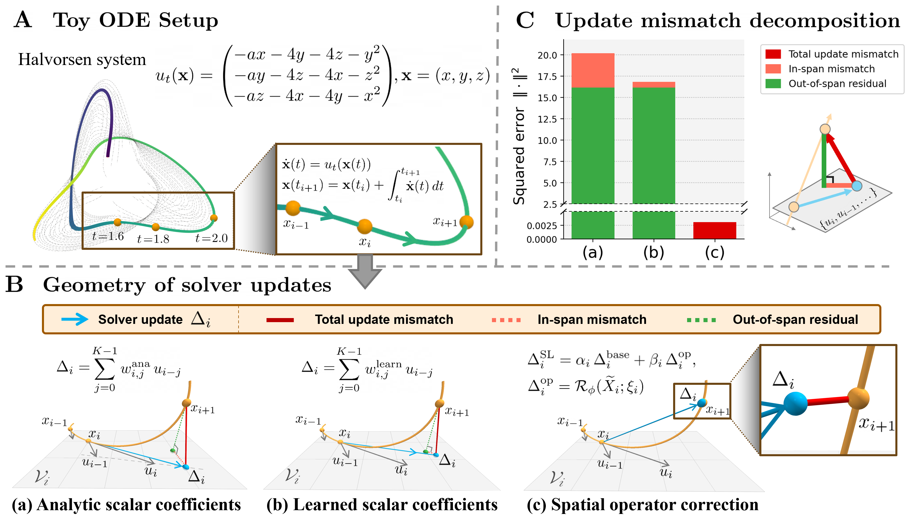

# Learning to Solve Generative ODEs Beyond the Linear Span


<!-- [](https://arxiv.org/abs/XXXX.XXXXX) -->

**Sihyeon Kim**<sup>1</sup>&nbsp;&nbsp; **Seunghun Lee**<sup>2</sup>&nbsp;&nbsp; **Vikas Singh**<sup>3,§</sup>&nbsp;&nbsp; **Hyunwoo J. Kim**<sup>2,§</sup>

<sup>1</sup>Korea University&nbsp;&nbsp;&nbsp; <sup>2</sup>KAIST&nbsp;&nbsp;&nbsp; <sup>3</sup>University of Wisconsin-Madison




Few-step ODE solvers for diffusion and flow models, whether analytic (iPNDM, DPM-Solver++) or learned (DyWeight, S4S), build each step as a scalar-weighted combination of buffered velocities, so the update can never leave the **linear span of the velocity buffer**. **SpanLift** keeps a fixed base solver as an **in-span prior** and adds a lightweight **spatial residual operator** over the state and velocity buffer that corrects the update beyond this span. It is trained by endpoint teacher matching, keeps the pretrained backbone frozen, and adds **no extra model NFEs**. With only 3 NFE, SpanLift improves FID from 8.16 to 5.69 on CIFAR-10 and from 17.37 to 11.83 on ImageNet 64×64.

## Code

🚧 **Coming soon.**

## Citation

```bibtex
@inproceedings{kim2026spanlift,
  title     = {Learning to Solve Generative {ODEs} Beyond the Linear Span},
  author    = {Kim, Sihyeon and Lee, Seunghun and Singh, Vikas and Kim, Hyunwoo J.},
  booktitle = {Advances in Neural Information Processing Systems},
  year      = {2026}
}
```
